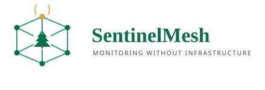

# SentinelMesh: 
> Solution Description, Cost, and Coverage

<p align="center">
  
</p>


Personal documentation repository for my participation in the **Climate Founders Track**, the climate tech edition of UNDP ICPSD's Virtual Digital Business Pre-Incubation (VDBI) programme[cite: 4].

**Participant:** Ahmad Deeb[cite: 4]
**Venture:** SentinelMesh — a solar-powered, self-healing IoT mesh for independent environmental monitoring in remote Syria[cite: 4]
**Programme dates:** Fri 6 Nov – Wed 16 Dec 2026[cite: 4]
**Status:** 🟡 In progress — problem and solution defined, Sessions 2–4 complete, MVP test design ready, customer discovery underway[cite: 4]

---

## 1. About the Programme

The Climate Founders Track is a seven-week, fully online pre-incubation programme run by the **United Nations Development Programme — Istanbul International Center for Private Sector in Development (UNDP ICPSD)**[cite: 4].

Over seven weeks, participants take a climate idea or early venture from a clear problem and first customer to an evidence-based pitch[cite: 4]. Every session adds one section to a venture workbook, so participants finish with:

- a complete **venture workbook**[cite: 4]
- a **pitch deck** (8–10 slides)[cite: 4]
- a **90-day action plan**[cite: 4]

### Who is supporting it

| Role | Name / Organisation |
|---|---|
| Programme owner | UNDP ICPSD (Istanbul International Center for Private Sector in Development)[cite: 4] |
| Programme coordination | Halit Duran, PhD — Entrepreneurship Research and Partnerships Analyst, UNDP ICPSD[cite: 4] |
| Lead Trainer | Mohammed Abdelaziz[cite: 4] |
| Trainer | Afonso Zinga[cite: 4] |
| Guest contributors | Climate and investment specialists (masterclasses from Week 2); jury of mentors, incubator managers and climate specialists at Demo Day[cite: 4] |
| Optional learning partner | HP LIFE (free self-paced courses, own certificates)[cite: 4] |

### Programme format

- **12 live sessions** of 2 hours, Wednesdays and Fridays, 15:00–17:00 Istanbul time (UTC+3). Session 12 is on Monday 14 December.[cite: 4]
- **Weekly outputs**, each becoming a section of the venture workbook.[cite: 4]
- **Three individual 60-minute mentoring sessions** per venture (Rounds: 9–13 Nov, 23–27 Nov, 7–11 Dec).[cite: 4]
- **Guest masterclasses** from Week 2.[cite: 4]
- **Demo Day** on Wed 16 Dec 2026: 4-minute pitch + 3 minutes of jury Q&A.[cite: 4]

### Certificate requirements

Issued after Demo Day only if **all three** are met:

- [ ] Attend at least **8 of 12** live sessions (recordings do not count)[cite: 4]
- [ ] Submit **all weekly outputs** + final workbook, pitch deck and 90-day action plan by **Tue 15 Dec**[cite: 4]
- [ ] Complete at least **2 of 3** mentoring sessions[cite: 4]

---

## 2. My Venture: SentinelMesh

**Tagline:** [suggested: *Monitoring without infrastructure.*][cite: 4]

### The climate problem

Remote areas of Syria face a compounding environmental risk: wildfires and drought are increasing, while the country's communication and power infrastructure remains severely damaged[cite: 4]. Forest rangers, farmers and researchers have no reliable way to monitor fire risk, soil and weather conditions, or wildlife and livestock in areas where cellular coverage and grid electricity cannot be assumed[cite: 4]. Early warning is the difference between a contained incident and a lost forest or harvest — but the monitoring systems that provide it depend on exactly the infrastructure that is missing[cite: 4].

### The solution

SentinelMesh is a **decentralised, solar-powered IoT mesh network** that provides independent, real-time environmental monitoring for remote areas[cite: 4]. It combines low-cost **ESP32 microcontrollers**, **solar power**, and **edge AI** to create a self-sustaining network that operates without relying on government infrastructure or constant electricity[cite: 4].

The system consists of two node types:

| Node type | Role | Components |
|---|---|---|
| **Edge Node** | Data collection and AI processing | ESP32-CAM, environmental sensors (temperature, humidity, soil moisture, solar irradiance), solar panel, battery[cite: 4] |
| **Backbone Node** | Mesh routing and data relay | ESP32, solar panel, battery, long-range antenna[cite: 4] |

Edge nodes capture images and sensor readings, run lightweight AI models locally, and transmit alerts and data through the mesh to a central dashboard[cite: 4]. The mesh topology ensures that if one node fails or loses connection, data still reaches its destination through alternative paths[cite: 4].

### How it works

**1. Data collection.** Edge nodes are deployed in forests, farms or remote areas[cite: 4]. Each is equipped with an ESP32-CAM for image capture, a DHT22 temperature/humidity sensor, a soil moisture sensor, and a solar irradiance sensor[cite: 4]. Data is collected at regular intervals (e.g. every 5 minutes); images are captured periodically (e.g. every 30 minutes) or triggered by motion or anomaly detection[cite: 4].

**2. Edge AI processing.** Lightweight YOLO models (e.g. YOLOv8n or TinyYOLO) run directly on the ESP32 or a companion edge device[cite: 4]. The model performs wildfire detection (smoke or fire in captured images), wildlife monitoring (detection and classification) and herd counting[cite: 4]. Only metadata (detection results, sensor readings) and thumbnail images are transmitted, reducing bandwidth and power consumption[cite: 4].

**3. Mesh networking.** Nodes communicate using ESP-MESH or LoRa mesh protocols[cite: 4]. Each node can act as a repeater, forwarding data from other nodes[cite: 4]. The mesh is self-healing: if a node fails, data automatically routes through alternative paths[cite: 4]. The network is independent of cellular or Wi-Fi infrastructure, making it suitable for remote areas[cite: 4].

**4. Data transmission and dashboard.** Data is relayed through the mesh to a Gateway Node connected to the internet via satellite or a local server[cite: 4]. The gateway uploads to a cloud dashboard providing real-time sensor readings, fire and anomaly alerts, historical trends, and wildlife and herd tracking logs[cite: 4].

**5. Power management.** Each node is powered by a solar panel and LiFePO4 battery with a charge controller[cite: 4]. ESP32 deep sleep between readings, edge AI models optimised for efficiency, and a mesh protocol that minimises transmission power ensure continuous operation during outages or in off-grid locations[cite: 4].

### MVP use cases

- **Hyper-local weather and soil monitoring** — real-time data for farmers and researchers[cite: 4]
- **Wildfire early warning** — smoke and fire detection via edge AI[cite: 4]
- **Automated wildlife tracking** — species identification and logging for ecological research[cite: 4]
- **Herd counting** — livestock monitoring for farmers[cite: 4]

### Primary customer for the pitch

[To be confirmed — recommend: **forest rangers and environmental agencies**, with wildfire early warning as the lead problem[cite: 4]. Secondary users: farmers and agricultural cooperatives, researchers and universities[cite: 4].]

### Users, needs and value

| User group | Primary need | SentinelMesh value |
|---|---|---|
| Forest rangers & environmental agencies | Early fire detection | Real-time alerts via mesh network[cite: 4] |
| Farmers & agricultural cooperatives | Yield and herd management | Direct economic impact through improved data[cite: 4] |
| Researchers & universities | Validation and field data | Early adopters who validate the technology and provide feedback[cite: 4] |

### Why this matters for Syria

- **War-affected infrastructure:** Syria's communication and power networks are severely damaged; SentinelMesh provides an independent solution[cite: 4].
- **Climate threats:** wildfires and droughts are increasing; early warning systems save lives and livelihoods[cite: 4].
- **Agricultural support:** farmers need real-time data to make informed decisions[cite: 4].
- **Low cost, high impact:** a single node costs roughly $50, making it accessible for NGOs, researchers and communities[cite: 4].

---

## 3. Technical Stack

| Component | Technology |
|---|---|
| Microcontroller | ESP32 / ESP32-CAM[cite: 4] |
| Mesh protocol | ESP-MESH (or LoRa mesh for longer range)[cite: 4] |
| AI framework | TensorFlow Lite for Microcontrollers (YOLOv8n / TinyYOLO)[cite: 4] |
| Sensors | DHT22, soil moisture, LDR, MQ-2 (smoke)[cite: 4] |
| Power | Solar panel (5–10 W), LiFePO4 battery, charge controller[cite: 4] |
| Dashboard | Web app (Flask/Django) or Power BI[cite: 4] |
| Data storage | Local SQLite / Cloud (Firebase, AWS IoT)[cite: 4] |

---

## 4. Cost and Coverage

### Approximate device costs

| Node type | Core components | Approximate cost (USD) |
|---|---|---|
| **Edge Node** (camera + sensors) | ESP32-CAM, DHT22, soil moisture sensor, LDR, solar panel (5 W), 18650 battery, TP4056 charger, weatherproof enclosure, antenna module | $80 – $110[cite: 4] |
| **Backbone Node** (mesh router) | ESP32 module, solar panel (5 W), 18650 battery, TP4056 charger, weatherproof enclosure, antenna module | $50 – $70[cite: 4] |

*Cost basis: a comparable ESP32-CAM wildlife monitoring node with solar power, battery, sensors and enclosure typically costs $60–80; adding the extended-range antenna module brings the total to the ranges shown[cite: 4].*

### Coverage range with antenna module

| Condition | Range with antenna module |
|---|---|
| Line-of-sight (LOS) | Up to 1.2 km[cite: 4] |
| Non-line-of-sight (NLOS, e.g. through vegetation or obstacles) | Up to 400 m[cite: 4] |

A single Edge Node with the antenna module can transmit approximately 1 km to a Backbone Node in open terrain, and maintain a reliable link at 400 m in forested or obstructed environments[cite: 4]. With Backbone Nodes acting as repeaters, coverage extends further by chaining hops — suitable for large agricultural fields, forest boundaries or remote ranger stations[cite: 4].

### Summary specifications

| Specification | Value |
|---|---|
| Edge Node cost | $80 – $110[cite: 4] |
| Backbone Node cost | $50 – $70[cite: 4] |
| Range (LOS, with antenna) | ~1.2 km[cite: 4] |
| Range (NLOS, with antenna) | ~400 m[cite: 4] |
| Power source | Solar panel + 18650 battery (off-grid)[cite: 4] |
| Sensors (Edge Node) | Camera, temperature, humidity, soil moisture, solar irradiance[cite: 4] |
| Modularity | New sensors can be added without redesign[cite: 4] |

### Key features and benefits

| Feature | Description | Benefit |
|---|---|---|
| Independent network | Operates without government infrastructure | Works in remote areas with no connectivity[cite: 4] |
| Solar-powered | Off-grid operation with battery backup | Continuous operation during power outages[cite: 4] |
| Edge AI | YOLO models run locally on nodes | Low latency, reduced bandwidth, privacy[cite: 4] |
| Self-healing mesh | Data routes around failed nodes | High reliability and resilience[cite: 4] |
| Multi-use case | Fire detection, wildlife tracking, herd counting, weather monitoring | Cost-effective for multiple stakeholders[cite: 4] |
| Low cost | ESP32 is affordable (~$10 per node) | Scalable for large deployments[cite: 4] |

---

## 5. What I Expect to End With

By the end of the programme (Wed 16 Dec 2026), I expect to have:

1. A **complete venture workbook** — one section per session, built on real customer evidence[cite: 4].
2. A **validated problem and customer segment** — a primary user (forest rangers / environmental agencies, or farmers) with an evidence log of interviews[cite: 4].
3. A **tested MVP hypothesis** — a one-page MVP test plan and, ideally, a working demonstration of two ESP32 nodes (1 Edge + 1 Backbone) with sensors and AI, relaying data over the mesh[cite: 4].
4. A **credible climate impact claim**, with a baseline, boundaries and at least two measurable indicators[cite: 4].
5. A **business model, pricing and 12-month cash plan**, plus a milestone-based funding strategy with two funding routes[cite: 4].
6. A **final pitch deck** (8–10 slides) covering problem, solution, impact, evidence, business model, competition, team, and next milestone/ask[cite: 4].
7. A **90-day action plan** for after Demo Day[cite: 4].
8. **Written jury feedback** from Demo Day and, potentially, a referral to incubation or acceleration programmes[cite: 4].
9. The **UNDP ICPSD digital certificate**, subject to meeting the three certificate conditions[cite: 4].

---

## 6. Expected Deliverables

| Deliverable | Description |
|---|---|
| Working prototype | 2 ESP32 nodes (1 Edge + 1 Backbone) with sensors and AI[cite: 4] |
| Mesh network demo | Proof-of-concept showing data relay between nodes[cite: 4] |
| Dashboard | Web interface for real-time monitoring and alerts[cite: 4] |
| Documentation | Full technical documentation, setup guide and code repository[cite: 4] |
| Final presentation | Slides and live demo for the capstone review[cite: 4] |

---

## 7. My Personal Task List

### Before Friday 6 November

- [x] Read the Participant Guide[cite: 4]
- [x] Choose one climate problem, one customer segment and one geography[cite: 4]
- [x] Prepare a 60-second introduction (problem, solution, target customer)[cite: 4]
- [x] Accept calendar invitations for all 12 sessions and Demo Day[cite: 4]
- [x] Test session link, audio and camera[cite: 4]
- [x] Join the cohort channel[cite: 4]
- [x] Reply to confirmation email (deadline: COB Thu 5 Nov 2026)[cite: 4]

### Weekly commitment

- [ ] Attend live sessions (Wed + Fri, 15:00–17:00 Damascus time)[cite: 4]
- [ ] Produce and upload each weekly output by Friday[cite: 4]
- [ ] Block ~6–8 hours per week (4h live + output + mentoring)[cite: 4]
- [ ] Inform programme team in advance of any absence[cite: 4]

### Mentoring

- [ ] Book Round 1 session (9–13 Nov)[cite: 4]
- [ ] Book Round 2 session (23–27 Nov)[cite: 4]
- [ ] Book Round 3 session (7–11 Dec)[cite: 4]
- [ ] Prepare materials + 2 concrete questions before each session[cite: 4]

### Masterclasses & optional learning

- [ ] Attend masterclasses from Week 2 (dates in cohort channel)[cite: 4]
- [ ] (Optional) Complete relevant HP LIFE courses[cite: 4]

### Final submission & Demo Day

- [ ] Upload first complete pitch draft before Session 12 (Mon 14 Dec)[cite: 4]
- [ ] Submit final workbook, pitch deck and 90-day action plan by **Tue 15 Dec**[cite: 4]
- [ ] Pitch at Demo Day — **Wed 16 Dec**[cite: 4]

---

## 8. Session Tracker

Legend: ⬜ Not started · 🔄 In progress · ✅ Done[cite: 4]

| # | Date | Session | Output | Status | Output file |
|---|---|---|---|---|---|
| 1 | Fri 6 Nov | Onboarding and programme introduction | — | ✅ Done | —[cite: 4] |
| 2 | Wed 11 Nov | Climate action categories and project examples | Session README (homework answer), value proposition, interview guide | ✅ Done | `sessions/02-customer-discovery/`[cite: 4] |
| 3 | Fri 13 Nov | Climate problem, first customer and MVP test design | One-page RAT plan (problem, customer, riskiest assumption A1, test, thresholds, decision rule) | ✅ Done | `sessions/03-mvp-test-plan/`[cite: 4] |
| 4 | Wed 18 Nov | Riskiest assumption and MVP test design: follow-up | Ranked 3 assumptions (A1 Technical 25, A2 Demand 20, A3 Viability 16), A1 test plan & assumption map | ✅ Done | `sessions/04-riskiest-assumption/` |
| 5 | Fri 20 Nov | AI Foundations for Climate Founders | — | ⬜ Not started | —[cite: 4] |
| 6 | Wed 25 Nov | Credible impact claims and measurement | Impact section with two indicators | ⬜ Not started | —[cite: 4] |
| 7 | Fri 27 Nov | Business model and customer value | Business model page and positioning sentence | ⬜ Not started | —[cite: 4] |
| 8 | Wed 2 Dec | Pricing and minimum viable cash plan | Provisional price, unit economics and 12-month cash plan | ⬜ Not started | —[cite: 4] |
| 9 | Fri 4 Dec | Milestone-based funding strategy | Milestone-and-funding page with two funding routes | ⬜ Not started | —[cite: 4] |
| 10 | Wed 9 Dec | Regulatory and market entry screening | Market-entry screening page | ⬜ Not started | —[cite: 4] |
| 11 | Fri 11 Dec | IP decisions and priority risks | IP-and-risk page; first complete pitch draft | ⬜ Not started | —[cite: 4] |
| 12 | Mon 14 Dec | Pitch rehearsal and the next 90 days | Revision list and 90-day action plan | ⬜ Not started | —[cite: 4] |
| — | Tue 15 Dec | Final submission (no live session) | Workbook, pitch deck and 90-day action plan | ⬜ Not started | —[cite: 4] |
| — | Wed 16 Dec | **Demo Day** | Live pitch | ⬜ Not started | —[cite: 4] |

*Note: Session titles for sessions 1–5 reflect the actual delivered sessions. Detailed summaries and output files for sessions 1 and 5 will be added once session materials are provided.*

---

## 9. Key Dates

| Item | Date |
|---|---|
| Confirmation deadline | Thu 5 Nov 2026[cite: 4] |
| Programme start | Fri 6 Nov 2026[cite: 4] |
| Mentoring Round 1 | 9–13 Nov 2026[cite: 4] |
| Mentoring Round 2 | 23–27 Nov 2026[cite: 4] |
| Mentoring Round 3 | 7–11 Dec 2026[cite: 4] |
| Final submission | Tue 15 Dec 2026[cite: 4] |
| Demo Day | Wed 16 Dec 2026[cite: 4] |

---

## 10. Contacts

### Programme

| Role | Contact |
|---|---|
| Programme coordination | Halit Duran, PhD — halit.duran@undp.org[cite: 4] |
| Lead Trainer | Mohammed Abdelaziz — mfathy@gmail.com[cite: 4] |
| Trainer | Afonso Zinga — afonso1zinga@yahoo.co.uk[cite: 4] |
| Cohort channel | [link to be shared][cite: 4] |

### Venture team

| Name | Email |
|---|---|
| Ahmad Deeb | ahmaddeebdev@gmail.com[cite: 4] |
| Nimra Afzaal | nimraafzaal1998@gmail.com[cite: 4] |
| Sular Albalkhi | sularalbalkhi@gmail.com[cite: 4] |
| Zaid Aldeen Mohammad Kiki | kikizaid2@gmail.com[cite: 4] |

---

## 11. Repository Structure

```text
.
├── README.md
├── CONTEXT.md
├── .gitignore
├── assets/
│   └── logo/
│       └── sentinelmesh-logo.svg
├── sessions/
│   ├── 01-problem-and-customer/
│   ├── 02-customer-discovery/
│   │   ├── README.md
│   │   ├── value-proposition.md
│   │   └── interview-guide.md
│   ├── 03-mvp-test-plan/
│   │   └── README.md
│   ├── 04-riskiest-assumption/
│   │   ├── README.md
│   │   └── assumption-map.md
│   ├── 05-competition-and-adoption/
│   ├── 06-impact-claims-and-measurement/
│   ├── 07-business-model/
│   ├── 08-pricing-and-cash-plan/
│   ├── 09-milestone-and-funding/
│   ├── 10-market-entry-screening/
│   ├── 11-ip-and-risk/
│   └── 12-pitch-rehearsal/
├── mentoring/
│   ├── round-1/
│   ├── round-2/
│   └── round-3/
├── customer-evidence/
│   └── evidence-log.md
├── workbook/
│   └── climate-founders-workbook.pdf
├── pitch/
│   ├── draft-v1.pptx
│   └── final-deck.pdf
├── action-plan/
│   └── 90-day-action-plan.md
├── firmware/
│   └── esp32-node/
│       ├── src/
│       ├── include/
│       ├── lib/
│       ├── platformio.ini
│       └── README.md
├── server/
│   ├── app/
│   │   ├── __init__.py
│   │   ├── models.py
│   │   ├── routes.py
│   │   └── services/
│   ├── migrations/
│   ├── tests/
│   ├── requirements.txt
│   ├── .env.example
│   └── README.md
└── mobile/
    ├── lib/
    ├── assets/
    ├── test/
    ├── pubspec.yaml
    └── README.md

```

### Code folders

| Folder | Purpose |
| --- | --- |
| `firmware/` | ESP32 node firmware — sensor reading, on-device YOLO inference, ESP-MESH networking, power management|
| `server/` | Backend API — ingests node data via gateway, stores readings and detections, serves the dashboard and mobile app|
| `mobile/` | Field-facing app — real-time alerts, sensor readings, detection logs|

---

## 12. Progress Log

| Date | Update |
| --- | --- |
| 04-Nov-2026 | Selected for the programme; received Participant Guide

 |
| 04-Nov-2026 | Chose climate problem, customer segment and geography

 |
| 04-Nov-2026 | Prepared 60-second introduction (Qatra — irrigation focus)

 |
| 11-Nov-2026 | ✅ **Session 2 complete.** Homework submitted: defined wildfire late-detection as the climate problem; primary customer named (forest protection agencies — Ministry of Emergency and Disaster Management, GORS/FIRMO, civil defence); category selected as **Climate data and early warning** (related: adaptation and resilience); first test defined as a controlled two-node smoke test at ~400 m NLOS, measuring detection, latency and mesh relay (tests A5, A7). Produced `value-proposition.md` (v1 — narrowed from multi-use platform to wildfire early detection) and `interview-guide.md` (Mom Test discovery guide targeting 3–5 interviews). Evidence documented: 12,000 ha forest lost in 2025 (2.0 Mt CO₂), 2,367 fire incidents Q1 2026, 40% tree-cover loss 2001–2025, UNDP Syria early-detection tender (Nov 2025).

 |
| 11-Nov-2026 | **Value proposition narrowed to v1:** from broad multi-use environmental monitoring (v0) to **one lead problem — wildfire early detection** — with one named primary customer. Multi-use cases (wildlife, herd, soil, weather) retained as expansion, not as the pitch. Rationale: Session 1 requires a singular problem-and-customer page; the evidence points to one urgent, funded, institutionally-owned problem.

 |
| 13-Nov-2026 | ✅ **Session 3 complete.** Trainers: Dr Amani Mohamed Ali (climate problem and first customer) and Prof. Afonso Zinga (riskiest assumption and MVP test design). Homework submitted: one-page RAT plan naming wildfire late-detection as the climate problem, forest protection agencies as first customer, and **A1 (ESP32-CAM + YOLO smoke detection at ≥ 80% recall / ≤ 20% false positives at 50–100 m daylight)** as the riskiest assumption. Test designed as a bench/field smoke test with pre-set thresholds (Proceed / Revise / Stop), 3-week cap, $250 cap, 30 trials, independent observer. Assumptions ranked by Impact × (6 – Evidence): A1 scored 25 (riskiest), A2 and A3 scored 20 each. Produced `sessions/03-mvp-test-plan/README.md`.

 |
| 18-Nov-2026 | ✅ **Session 4 complete.** Trainer: Prof. Afonso Zinga. Ranked three assumptions across Technical, Demand, and Viability using Impact × (6 – Evidence): **A1 Technical (25)**, **A2 Demand (20)**, and **A3 Viability (16)**. Defined the A1 (ESP32-CAM + YOLOv8n smoke detection) test with recall, false-positive, and latency metrics, pre-set Proceed/Revise/Stop thresholds, 3-week / $250 / 30-trial caps, and next-step decision rules. Produced `sessions/04-riskiest-assumption/README.md` and `sessions/04-riskiest-assumption/assumption-map.md`. |
