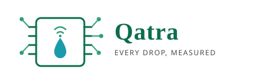

<p align="center">
  
  <br>
  <em>Every drop, measured.</em>
</p>

---

# Climate Founders Track

Personal documentation repository for my participation in the **Climate Founders Track**, the climate tech edition of UNDP ICPSD's Virtual Digital Business Pre-Incubation (VDBI) programme.

**Participant:** Ahmad Deeb

**Programme dates:** Fri 6 Nov – Wed 16 Dec 2026

**Status:** 🔄 In progress — accepted, pre-programme preparation

---

## 1. About the Programme

The Climate Founders Track is a seven-week, fully online pre-incubation programme run by the **United Nations Development Programme — Istanbul International Center for Private Sector in Development (UNDP ICPSD)**.

Over seven weeks, participants take a climate idea or early venture from a clear problem and first customer to an evidence-based pitch. Every session adds one section to a venture workbook, so participants finish with:

- a complete **venture workbook**
- a **pitch deck** (8–10 slides)
- a **90-day action plan**

### Who is supporting it

| Role | Name / Organisation |
|---|---|
| Programme owner | UNDP ICPSD (Istanbul International Center for Private Sector in Development) |
| Programme coordination | Halit Duran, PhD — Entrepreneurship Research and Partnerships Analyst, UNDP ICPSD |
| Lead Trainer | Mohammed Abdelaziz |
| Trainer | Afonso Zinga |
| Guest contributors | Climate and investment specialists (masterclasses from Week 2); jury of mentors, incubator managers and climate specialists at Demo Day |
| Optional learning partner | HP LIFE (free self-paced courses, own certificates) |

### Programme format

- **12 live sessions** of 2 hours, Wednesdays and Fridays, 15:00–17:00 Istanbul time (UTC+3). Session 12 is on Monday 14 December.
- **Weekly outputs**, each becoming a section of the venture workbook.
- **Three individual 60-minute mentoring sessions** per venture (Rounds: 9–13 Nov, 23–27 Nov, 7–11 Dec).
- **Guest masterclasses** from Week 2.
- **Demo Day** on Wed 16 Dec 2026: 4-minute pitch + 3 minutes of jury Q&A.

### Certificate requirements

Issued after Demo Day only if **all three** are met:

- [ ] Attend at least **8 of 12** live sessions (recordings do not count)
- [ ] Submit **all weekly outputs** + final workbook, pitch deck and 90-day action plan by **Tue 15 Dec**
- [ ] Complete at least **2 of 3** mentoring sessions

---

## 2. My Venture

**Working title:** **Qatra**

**Climate problem:**
Inefficient irrigation and wasted freshwater among farmers in water-scarce regions, caused by a lack of reliable local soil moisture and weather data. Existing monitoring stations are too sparse and too expensive, and forecast models are weakest where water stress is highest.

**Proposed solution:**
A low-power **ESP32 sensor network** that collects soil moisture, temperature and humidity data in the field. Nodes communicate through a **self-organising mesh network**, so no internet or cellular coverage is needed at field level. Lightweight **AI runs on-device** to filter noise, detect anomalies and determine irrigation needs; only consolidated insights and alerts are relayed to a gateway and forwarded to the user.

**Target customer:** Smallholder farmers

**Geography:** rural Damascus

**Initial climate impact indicators:**
- Freshwater saved through data-guided irrigation scheduling
- Reduction in pumping energy consumption per hectare
- Reduction in crop loss attributable to water stress

---

## 3. What I Expect to End With

By the end of the programme (Wed 16 Dec 2026), I expect to have:

1. A **complete venture workbook** — one section per session, built on real customer evidence.
2. A **validated problem and customer segment**, supported by an evidence log of interviews with potential customers.
3. A **tested MVP hypothesis** — a one-page MVP test plan and, ideally, results from a small field test.
4. A **credible climate impact claim**, with a baseline, boundaries and at least two measurable indicators.
5. A **business model, pricing and 12-month cash plan**, plus a milestone-based funding strategy with two funding routes.
6. A **final pitch deck** (8–10 slides) covering problem, solution, impact, evidence, business model, competition, team, and next milestone/ask.
7. A **90-day action plan** for what happens after Demo Day.
8. **Written jury feedback** from Demo Day and, potentially, a referral to incubation or acceleration programmes.
9. The **UNDP ICPSD digital certificate**, subject to meeting the three certificate conditions.

---

## 4. My Personal Task List

### Before Friday 6 November

- [x] Read the Participant Guide
- [x] Choose one climate problem, one customer segment and one geography
- [x] Prepare a 60-second introduction (problem, solution, target customer)
- [ ] Accept calendar invitations for all 12 sessions and Demo Day
- [ ] Test session link, audio and camera
- [ ] Join the cohort channel
- [ ] Reply to confirmation email (deadline: COB Thu 5 Nov 2026)

### Weekly commitment

- [ ] Attend live sessions (Wed + Fri, 15:00–17:00 Damascus time)
- [ ] Produce and upload each weekly output by Friday
- [ ] Block ~6–8 hours per week (4h live + output + mentoring)
- [ ] Inform programme team in advance of any absence

### Mentoring

- [ ] Book Round 1 session (9–13 Nov)
- [ ] Book Round 2 session (23–27 Nov)
- [ ] Book Round 3 session (7–11 Dec)
- [ ] Prepare materials + 2 concrete questions before each session

### Masterclasses & optional learning

- [ ] Attend masterclasses from Week 2 (dates in cohort channel)
- [ ] (Optional) Complete relevant HP LIFE courses

### Final submission & Demo Day

- [ ] Upload first complete pitch draft before Session 12 (Mon 14 Dec)
- [ ] Submit final workbook, pitch deck and 90-day action plan by **Tue 15 Dec**
- [ ] Pitch at Demo Day — **Wed 16 Dec**

---

## 5. Session Tracker

Legend: ⬜ Not started · ✅ Done

| # | Date | Session | Output | Status | Output file |
|---|---|---|---|---|---|
| 1 | Fri 6 Nov | Climate problem and first customer | Problem-and-customer page with market range; pitch outline | ⬜ Not started | — |
| 2 | Wed 11 Nov | Customer discovery and value proposition | Value proposition, interview guide and evidence log | ⬜ Not started | — |
| 3 | Fri 13 Nov | Riskiest assumption and MVP test design | One-page MVP test plan | ⬜ Not started | — |
| 4 | Wed 18 Nov | Climate impact baseline and boundaries | Preliminary impact worksheet | ⬜ Not started | — |
| 5 | Fri 20 Nov | Competition and the route to adoption | Competition-and-adoption page | ⬜ Not started | — |
| 6 | Wed 25 Nov | Credible impact claims and measurement | Impact section with two indicators | ⬜ Not started | — |
| 7 | Fri 27 Nov | Business model and customer value | Business model page and positioning sentence | ⬜ Not started | — |
| 8 | Wed 2 Dec | Pricing and minimum viable cash plan | Provisional price, unit economics and 12-month cash plan | ⬜ Not started | — |
| 9 | Fri 4 Dec | Milestone-based funding strategy | Milestone-and-funding page with two funding routes | ⬜ Not started | — |
| 10 | Wed 9 Dec | Regulatory and market entry screening | Market-entry screening page | ⬜ Not started | — |
| 11 | Fri 11 Dec | IP decisions and priority risks | IP-and-risk page; first complete pitch draft | ⬜ Not started | — |
| 12 | Mon 14 Dec | Pitch rehearsal and the next 90 days | Revision list and 90-day action plan | ⬜ Not started | — |
| — | Tue 15 Dec | Final submission (no live session) | Workbook, pitch deck and 90-day action plan | ⬜ Not started | — |
| — | Wed 16 Dec | **Demo Day** | Live pitch | ⬜ Not started | — |

---

## 6. Key Dates

| Item | Date |
|---|---|
| Confirmation deadline | Thu 5 Nov 2026 |
| Programme start | Fri 6 Nov 2026 |
| Mentoring Round 1 | 9–13 Nov 2026 |
| Mentoring Round 2 | 23–27 Nov 2026 |
| Mentoring Round 3 | 7–11 Dec 2026 |
| Final submission | Tue 15 Dec 2026 |
| Demo Day | Wed 16 Dec 2026 |

---

## 7. Contacts

| Role | Contact |
|---|---|
| Programme coordination | Halit Duran, PhD — halit.duran@undp.org |
| Lead Trainer | Mohammed Abdelaziz — mfathy@gmail.com |
| Trainer | Afonso Zinga — afonso1zinga@yahoo.co.uk |
| Cohort channel | [link to be shared] |

---

## 8. Repository Structure

```
.
├── README.md
├── sessions/
│   ├── 01-problem-and-customer/
│   ├── 02-customer-discovery/
│   ├── 03-mvp-test-plan/
│   ├── 04-impact-baseline/
│   ├── 05-competition-and-adoption/
│   ├── 06-impact-claims-and-measurement/
│   ├── 07-business-model/
│   ├── 08-pricing-and-cash-plan/
│   ├── 09-milestone-and-funding/
│   ├── 10-market-entry-screening/
│   ├── 11-ip-and-risk/
│   └── 12-pitch-rehearsal/
├── mentoring/
│   ├── round-1/
│   ├── round-2/
│   └── round-3/
├── customer-evidence/
│   └── evidence-log.md
├── workbook/
│   └── climate-founders-workbook.pdf
├── pitch/
│   ├── draft-v1.pptx
│   └── final-deck.pdf
│── action-plan/
│    └── 90-day-action-plan.md
└── firmware/
   ├── esp32-edge-node/
   └── esp32-back-node/

```

---

## 9. Progress Log

| Date | Update |
|---|---|
| [04-Nov-2026] | Selected for the programme; received Participant Guide |
| [04-Nov-2026] | Chose climate problem, customer segment and geography |
| [05-Nov-2026] | Prepared 60-second introduction |

---

*This repository documents my work in the UNDP ICPSD Climate Founders Track (Nov–Dec 2026). It is a personal record; programme materials remain the property of UNDP ICPSD.*